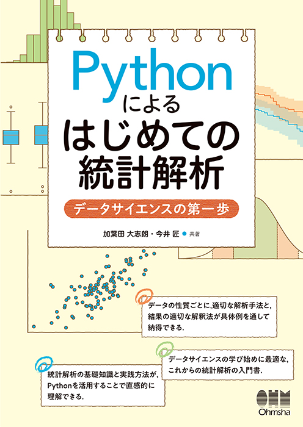

# Pythonによるはじめての統計解析 — サポートページ（GitHub レポジトリ）

**著者**：加葉田大志朗・今井匠 共著<br>
**出版社**：オーム社（[書籍ページ](https://www.ohmsha.co.jp/book/9784274235368.html)）<br>
**発行**：2026年11月30日 第1版第1刷<br>
**ISBN**：978-4-274-23536-8<br>
**前著**：加葉田大志朗『医学研究のためのRによる統計解析入門』（2023，オーム社，[サポートページ](https://github.com/kabajiro/Rcode_Ohmsha_2023)）

『Pythonによるはじめての統計解析 ―データサイエンスの第一歩―』の読者向けサポートページ（GitHub レポジトリ）です．本書の「Pythonを用いた分析」で使用するデータセットと，「Pythonを用いた分析」・オンラインコンテンツの単一HTMLを配布しています．

<br clear="all">

## オンラインで読む（GitHub Pages）

ブラウザで直接読みやすい形に整形されたバージョンは以下のURLからご覧いただけます．

- **Pythonを用いた分析**: <https://kabajiro.github.io/Pythoncode_Ohmsha_2026/files/practice.html>
- **オンラインコンテンツ**: <https://kabajiro.github.io/Pythoncode_Ohmsha_2026/files/appendix.html>

※ このサポートページに戻れるよう別タブで開きたい場合は，**Ctrl + クリック**（Windows）または **⌘ + クリック**（Mac），あるいは右クリック→「新しいタブで開く」をご利用ください．

## 正誤表

刊行後に判明した誤りと訂正の内容は，以下のページにまとめています．

- **正誤表**: <https://kabajiro.github.io/Pythoncode_Ohmsha_2026/errata.html>

誤りと思われる箇所を見つけた場合は，オーム社の[書籍お問合せフォーム](https://www.ohmsha.co.jp/contact/book.php?isbn=978-4-274-23536-8)からお知らせください．

## ディレクトリ構成

| パス | 内容 |
|---|---|
| [`/data/`](data/) | 「Pythonを用いた分析」で使用するデータセット（CSV）：Student Performance / Bank Marketing / Rossi 再犯データ |
| [`/files/`](files/) | 「Pythonを用いた分析」・オンラインコンテンツの HTML（GitHub Pages で公開中） |

## データセットの読み込み方

書籍中の「Pythonを用いた分析」のコードでは，以下のように URL から直接データを読み込みます．

```python
import pandas as pd

df = pd.read_csv(
    "https://raw.githubusercontent.com/kabajiro/"
    "Pythoncode_Ohmsha_2026/main/data/student-por.csv",
    sep=";"  # セミコロン区切りのCSVファイルを指定
)
```

各データセットの出典・ライセンス・対応章の詳細は [`data/README.md`](data/README.md) を参照してください．

## ライセンス

- データセット：CC BY 4.0（出典は `data/README.md` に記載）
- HTML：書籍購入者向けの参考資料として無償公開
