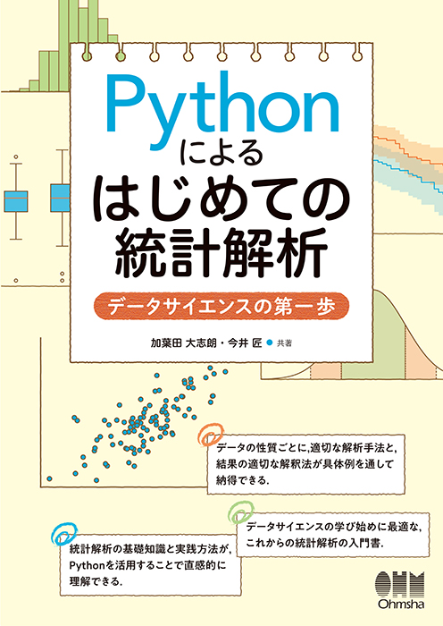

<h1>正誤表</h1>

『Pythonによるはじめての統計解析 ―データサイエンスの第一歩―』

<dl>
<dt>著者</dt><dd>加葉田大志朗・今井匠 共著</dd>
<dt>出版社</dt><dd>オーム社（<a href="https://www.ohmsha.co.jp/book/9784274235368.html">書籍ページ</a>）</dd>
<dt>発行</dt><dd>2026年11月30日 第1版第1刷</dd>
<dt>ISBN</dt><dd>978-4-274-23536-8</dd>
<dt>最終更新</dt><dd>2026年11月20日</dd>
</dl>

刊行後に判明した誤りと訂正の内容を，このページで随時お知らせします．

[公開リソース（GitHub リポジトリ）に戻る](https://github.com/kabajiro/Pythoncode_Ohmsha_2026)

## 第1版第1刷

現在のところ，訂正はありません．

<!--
訂正を追加するときは，上の er-note を消して次の表を使い，見出しカードの最終更新日も直す（新しいものを上に）．

| 頁 | 箇所 | 誤 | 正 | 掲載日 |
|---|---|---|---|---|
| p.000 | 3.2.1 項 本文 5 行目 | （誤りの記述） | （正しい記述） | 2026-00-00 |
-->

## 誤りを見つけたら

本書の記述やコードに誤りと思われる箇所を見つけた場合は，オーム社の[書籍お問合せフォーム](https://www.ohmsha.co.jp/contact/book.php?isbn=978-4-274-23536-8)からお知らせください．頁番号と該当箇所（節・項，図表番号，コードの行など）を書き添えていただけると，確認がはやく進みます．オーム社の[書籍ページ](https://www.ohmsha.co.jp/book/9784274235368.html#errata)の「正誤表」欄もあわせてご確認ください．

訂正が「Pythonを用いた分析」や「オンラインコンテンツ」の内容に関わる場合は，HTML 版（[Pythonを用いた分析](files/practice.html)・[オンラインコンテンツ](files/appendix.html)）も合わせて更新します．
